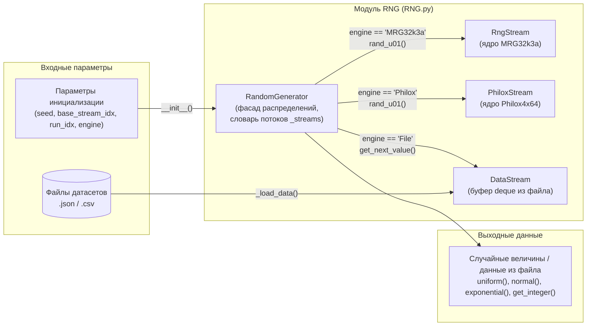
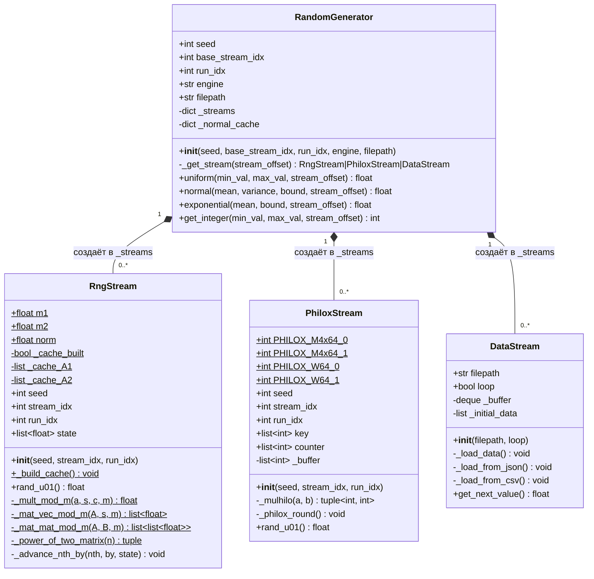
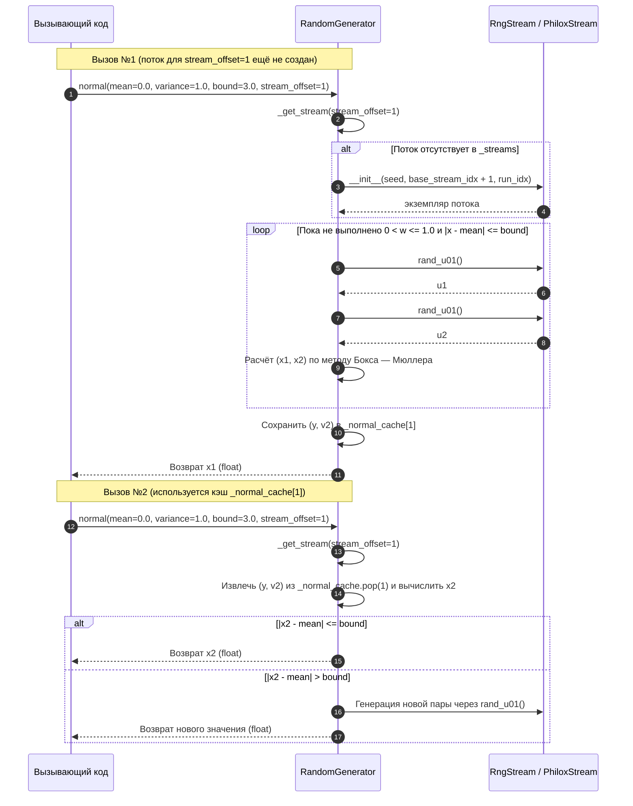
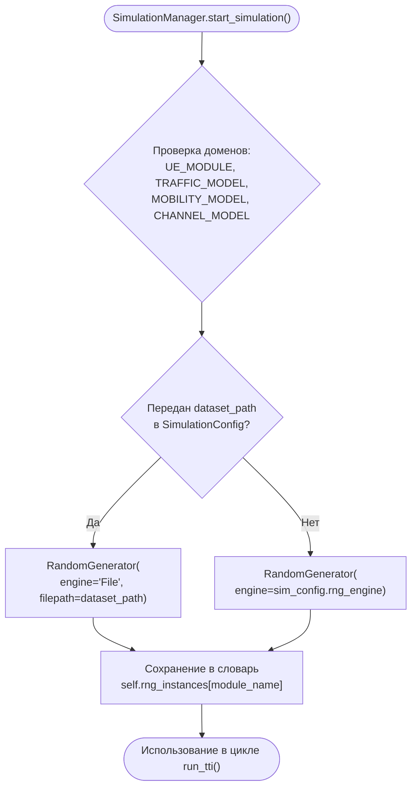

# Диаграммы модуля RNG

> Ответственный: Шаимов Богдан | Проверено по коду: RNG_brenсh2d2f164

## 1. Текущая структура (AS-IS)

Кратко: показано внутреннее устройство модуля `RNG.py` (v1.2.0) в ветке `RNG_brench`. Фасад `RandomGenerator` управляет созданием потоков и в зависимости от параметра `engine` делегирует генерацию одному из трёх классов: `RngStream` (`MRG32k3a`), `PhiloxStream` (`Philox4x64`) или `DataStream` (чтение `.json`/`.csv`).

### 1.1. Схема компонентов и потоков данных модуля (AS-IS)

### 1.2. UML-диаграмма классов модуля RNG.py (AS-IS)

## 2. Типовой сценарий (AS-IS)

Сценарий: запрос случайной величины через `RandomGenerator.normal()` при двух последовательных обращениях к одному `stream_offset` (демонстрация ленивого создания потока и работы кэша `_normal_cache`).

## 3. Целевая структура (TO-BE)

> Не согласовано, см. `docs/features.md` и `docs/spec_FEAT-RNG-001.md`.
> Внутри самого модуля `RNG.py` архитектура классов (`RandomGenerator`, `RngStream`, `PhiloxStream`, `DataStream`) сохраняется. Предлагаемая схема фабричной инициализации `RandomGenerator` в словаре `rng_instances` на стороне `SimulationManager` показана ниже для согласования с владельцем модуля `SIMULATION_MANAGER`.

## 4. Ссылки на исходники

- `RNG.py::RngStream` — математическое ядро `MRG32k3a` (`_build_cache`, `_advance_nth_by`, `rand_u01`).
- `RNG.py::PhiloxStream` — математическое ядро `Philox4x64` (`_philox_round`, `_mulhilo`, `rand_u01`).
- `RNG.py::DataStream` — чтение датасетов из `.json` и `.csv` (`_load_data`, `_load_from_json`, `_load_from_csv`, `get_next_value`).
- `RNG.py::RandomGenerator` — точка входа для работы с распределениями и потоками (`_get_stream`, `uniform`, `normal`, `exponential`, `get_integer`).
