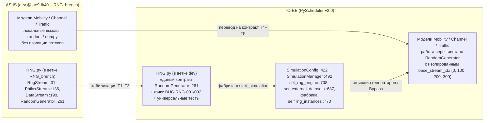

# SPEC-FEAT-RNG-001 — Независимый модуль генерации случайных последовательностей и контракт интеграции (v1)

> Ответственный: Шаимов Богдан (RNG) | Проверено по коду: `RNG_brenсh2d2f164`| Обновлено: `2026-10-21`  
> Статус: v1 — спецификация готова к согласованию межмодульных контрактов и реализации недельными задачами (раздел 7). Реестровая запись: [features.md](../features.md) `FEAT-RNG-001` — архитектурная фича: выделение генерации ПСЧ (`MRG32k3a`, `Philox4x64`) и чтения статических датасетов (`DataStream`) в независимый модуль с единым фасадом `RandomGenerator`; прежние обозначения записей сохранены в таблице соответствия [audit.md §1](../audit.md). Схемы AS-IS/TO-BE: [diagrams.md](../diagrams.md) §1/§3; наблюдения: [audit.md](../audit.md).

## 1. Цель

В текущей ветке `dev` генерация случайных величин в моделях мобильности (`MOBILITY_MODEL.py`), радиоканала (`CHANNEL_MODEL.py`) и трафика (`TRAFFIC_MODEL.py`) не имеет единой точки входа, изоляции потоков и управления со стороны `SIMULATION_MANAGER.py`. Использование общего генератора приводит к взаимному влиянию подсистем (изменение параметров трафика сдвигает случайную последовательность для мобильности и канала), а также не позволяет централизованно переключать математический алгоритм или подавать предзаписанные датасеты (`.csv`, `.json`) без переписывания кода самих моделей.

В ветке `RNG_brench` разработан автономный модуль `RNG.py` (:1–356), объединяющий математические ядра `RngStream` (:31), `PhiloxStream` (:136), файловый поток `DataStream` (:198) и фасад распределений `RandomGenerator` (:261). Цель этой спецификации — зафиксировать внешние контракты `RNG.py` и схему его подключения к ядру и моделям для перехода к архитектуре `PyScheduler v2.0.0` так, чтобы:

- ядро (`SIMULATION_MANAGER.py`) и модели взаимодействовали только с фасадом `RandomGenerator` (:261), не завися от внутреннего устройства алгоритмов `MRG32k3a`, `Philox4x64` и `DataStream`;
- каждая подсистема (`UE`, `Mobility`, `Channel`, `Traffic`) имела изолированный диапазон потоков (`base_stream_idx` + `stream_offset`) и единого владельца состояния генерации;
- поддерживалось прозрачное переключение между математической генерацией и прямым чтением статических датасетов (`engine='File'`, режим Direct Bypass) при побитовой воспроизводимости эталонных сценариев (NS-3 и Python).

## 2. Входит / не входит

**Входит:** Добавление модуля `RNG.py` (:1–356) в ветку `dev`; публичный контракт фасада `RandomGenerator` (:261) и ядер `RngStream` (:31), `PhiloxStream` (:136), `DataStream` (:198); проверка и закрытие локальных наблюдений ревизии (`[BUG-RNG-001](../audit.md#bug-rng-001)` в `get_integer` :346, `[BUG-RNG-002](../audit.md#bug-rng-002)` в `normal` :302 и `exponential` :332, `[OPT-RNG-001](../audit.md#opt-rng-001)` :311/:324); рефакторинг тестового набора `RNG` с переходом на универсальные параметризованные тесты (`[FEAT-RNG-002](../features.md#feat-rng-002)`); контракт интеграции с `SimulationConfig` (:422) и `SimulationManager` (:492) (`set_rng_engine`, `set_external_datasets`, фабрика `rng_instances`).

**Не входит:** переписывание внутренних физических формул в `MOBILITY_MODEL.py`, `CHANNEL_MODEL.py`, `TRAFFIC_MODEL.py` (выполняется владельцем моделей по контракту раздела 4, запрос в [features.md](../features.md) §2); разработка парсера аргументов `CLI` (запрос владельцу CLI в [features.md](../features.md) §2); разделение `SimulationManager` и `StatsManager` (отдельная задача владельца Core); многоколоночная маршрутизация внутри одного CSV/JSON файла по `stream_offset` (`[FEAT-RNG-003](../features.md#feat-rng-003)` / `[DEBT-RNG-001](../audit.md#debt-rng-001)` — вынесено в отдельную задачу по запросу моделей).

## 3. AS-IS: матрица ответственности компонентов `RNG.py`

| Класс (`RNG.py` :строка) | Алгоритм / Назначение | Выходной метод ядра | Управление потоками и прогонами | Собственное состояние |
|---|---|---|---|---|
| `RngStream` (:31) | Комбинированный генератор `MRG32k3a` (стандарт NS-3), модули `m1`/`m2` (:35–36), матрицы перехода `A1p0`/`A2p0` (:43–53) | `rand_u01() -> float` на $(0, 1)$ (:82–95) | Матричный сдвиг `_advance_nth_by` (:125): поток $2^{127}$ (`stream_idx` :76–79), прогон $2^{76}$ (`run_idx` :80) | Вектор `state: list[float]` из 6 элементов (:75); статический кэш 190 матриц `_cache_A1`, `_cache_A2` (:55–70) |
| `PhiloxStream` (:136) | Counter-based генератор `Philox4x64` (10 раундов :173, 64-битное умножение `_mulhilo` :156) | `rand_u01() -> float` на $[0, 1)$ делением на $2^{64}$ (:191–196) | Ключ `key = [seed, stream_idx]` (:150); счётчик `counter = [0, 0, 0, run_idx]` (:152) | 256-битный `counter` (:152, инкремент :163–169), буфер на 4 числа `_buffer: list[int]` (:154, запись :189, чтение `.pop()` :195) |
| `DataStream` (:198) | Потоковое чтение предзаписанных чисел из `.json` (:229) и `.csv` (:242) для подмены математических ядер | `get_next_value() -> float` (:252–259) | Один экземпляр на файл; параметр циклического повтора `loop: bool = True` (:203) | Очередь чтения `_buffer: deque[float]` (:206), резервная копия `_initial_data: list[float]` (:207, перезаполнение :256) |
| `RandomGenerator` (:261) | Единый фасад распределений (`uniform` :296, `normal` :302, `exponential` :332, `get_integer` :346) и фабрика потоков `_get_stream` (:276) | Четыре метода распределений (:296–356) | Смещение `stream_idx = base_stream_idx + stream_offset` (:285, :291) | Словарь активных потоков `_streams: dict[int, Stream]` (:273), кэш пар Бокса — Мюллера `_normal_cache: dict[int, tuple]` (:274) |

Три архитектурных наблюдения по текущему коду (`RNG.py`), которые определяют контракты этой спецификации:

1. **Единый фасад скрывает различие между математикой и файлом.** В `RandomGenerator` переключение между `RngStream`, `PhiloxStream` и `DataStream` полностью локализовано внутри `_get_stream` (:276–294) и проверок `if self.engine == 'File':` (:298, :305, :335, :352). Это позволяет вызывающему коду (моделям или циклу `run_tti` в `SIMULATION_MANAGER.py` :995–1035) вызывать одни и те же методы без знания того, считаются ли числа по формулам или берутся из `.csv`/`.json`.
2. **Кэш нормального распределения привязан к `stream_offset`.** Полярный метод Бокса — Мюллера в `RandomGenerator.normal` (:314–330) за одну итерацию генерирует пару независимых величин `x1`, `x2`. Вторая величина сохраняется в `_normal_cache[stream_offset]` (:326) и извлекается при следующем вызове (:308). Поэтому `RandomGenerator` обязан единолично владеть связкой `_streams` и `_normal_cache` для каждого смещения потока.
3. **Граничные случаи параметров требуют явной защиты на входе фасада.** При ревизии выявлено, что в `get_integer` (:356) приведение `int()` округляет к нулю вместо `math.floor()`, что может смещать вероятности при `min_val < 0` (`[BUG-RNG-001](../audit.md#bug-rng-001)`), а передача отрицательного `bound < 0` в `normal` (:325) или `exponential` (:343) приводит к невыполнимому условию выхода из `while True` (`[BUG-RNG-002](../audit.md#bug-rng-002)`). Эти проверки должны выполняться внутри методов `RandomGenerator` без изменения сигнатур вызовов.

## 4. Целевые контракты

### 4.1 Владение состоянием генерации внутри `RNG.py`

Никаких глобальных переменных состояния на уровне модуля не вводится (кроме неизменяемого после инициализации кэша матриц перехода `RngStream._cache_A1`/`_cache_A2` :56–57). Владелец состояния потоков — экземпляр `RandomGenerator`.

| Поле состояния | Тип | Читатели | Писатель (единственный) | Где живёт в `RNG.py` |
|---|---|---|---|---|
| `RngStream._cache_A1`, `_cache_A2` | `list[list[list[float]]]` | `RngStream._power_of_two_matrix` (:122) | `RngStream._build_cache` (:59–70, однократно при `_cache_built == False`) | Атрибуты класса `RngStream` (:55–57) |
| `RngStream.state` | `list[float]` (6 элементов) | `RngStream.rand_u01` (:82) | `RngStream.__init__` (:75–80) и `RngStream.rand_u01` (:86, :91) | Поле экземпляра `RngStream` (:75) |
| `PhiloxStream.counter`, `_buffer` | `list[int]`, `list[int]` | `PhiloxStream.rand_u01` (:193–195) | `PhiloxStream._philox_round` (:163–189) и `.pop()` в `rand_u01` (:195) | Поля экземпляра `PhiloxStream` (:152–154) |
| `DataStream._buffer` | `deque[float]` | `DataStream.get_next_value` (:254) | `DataStream._load_data` (:214) и `get_next_value` (`popleft` :259, `extend` :256) | Поле экземпляра `DataStream` (:206) |
| `RandomGenerator._streams` | `dict[int, RngStream \| PhiloxStream \| DataStream]` | Все методы распределений через `_get_stream` (:276) | `RandomGenerator._get_stream` (:281, :283, :289 — ленивое создание по `stream_offset`) | Поле экземпляра `RandomGenerator` (:273) |
| `RandomGenerator._normal_cache` | `dict[int, tuple[float, float]]` | `RandomGenerator.normal` (:307) | `RandomGenerator.normal` (запись :326, удаление `.pop()` :308) | Поле экземпляра `RandomGenerator` (:274) |

### 4.2 Контракт ядер потоков (`RngStream`, `PhiloxStream`, `DataStream`)

```python
# Математические ядра (RngStream :31, PhiloxStream :136)
Stream.rand_u01() -> float          # число из полуинтервала [0.0, 1.0)

# Файловое ядро (DataStream :198)
DataStream.get_next_value() -> float # очередное число из очереди deque (.json / .csv)
```

- Вызов ядер снаружи модуля `RNG.py` не требуется (допускается только в unit-тестах побитовой сверки с эталоном NS-3 и Python).
- В `RngStream` при `seed == 0` автоматически подставляется `12345` (:72); аналогичное правило действует в `PhiloxStream` (:146) и `RandomGenerator` (:268).

### 4.3 Контракт фасада распределений (`RandomGenerator`)

```python
RandomGenerator(seed=12345, base_stream_idx=0, run_idx=1, engine='MRG32k3a', filepath=None)

RandomGenerator.uniform(min_val=0.0, max_val=1.0, stream_offset=0) -> float
RandomGenerator.normal(mean=0.0, variance=1.0, bound=float('inf'), stream_offset=0) -> float
RandomGenerator.exponential(mean=1.0, bound=0.0, stream_offset=0) -> float
RandomGenerator.get_integer(min_val: int, max_val: int, stream_offset=0) -> int
```

- **Сохранение сигнатур:** имена и порядок аргументов полностью сохраняют обратную совместимость с версией `v1.2.0` (:267–356).
- **Уточнение реализации внутри методов (задача T1):**
  - в `get_integer` (:356) формула `int(min_val + v * (max_val - min_val + 1))` заменяется на `math.floor(min_val + v * (max_val - min_val + 1))` для устранения смещения на отрицательных диапазонах (`[BUG-RNG-001](../audit.md#bug-rng-001)`);
  - в `normal` (:302) и `exponential` (:332) добавляется проверка `if bound < 0: raise ValueError(...)` перед циклом `while True` (`[BUG-RNG-002](../audit.md#bug-rng-002)`), а вычисление `math.sqrt(variance)` выносится один раз до цикла (`[OPT-RNG-001](../audit.md#opt-rng-001)`).
- **Поведение в режиме `engine == 'File'`:** методы `uniform`, `normal`, `exponential` возвращают `stream.get_next_value()` напрямую без масштабирования (:298, :305, :335), а `get_integer` возвращает `int(stream.get_next_value())` (:353). Это обеспечивает прямую передачу предрассчитанных физических величин (координат, SINR, размеров пакетов) из статического датасета.

### 4.4 Контракт интеграции с ядром (`SIMULATION_MANAGER.py`) и моделями

Ядро симуляции взаимодействует с `RNG.py` через конфигурацию `SimulationConfig` (:422) и словарь экземпляров `self.rng_instances` (:770):

| Точка контракта | Сигнатура / Поля | Назначение и место в коде |
|---|---|---|
| Поля `SimulationConfig` | `rng_engine: str = 'MRG32k3a'`, `ue_dataset_path`, `traffic_dataset_path`, `mobility_dataset_path`, `channel_dataset_path: Optional[str] = None` | Хранение выбранного алгоритма и путей к статическим датасетам (`SIMULATION_MANAGER.py` :444–449) |
| `set_rng_engine` | `set_rng_engine(engine: str) -> None` | Публичная ручка переключения `'MRG32k3a'` / `'Philox'` с валидацией (`SIMULATION_MANAGER.py` :708–716) |
| `set_external_datasets` | `set_external_datasets(ue_path=None, traffic_path=None, mobility_path=None, channel_path=None) -> None` | Единый фасадный сеттер для установки путей к `.csv`/`.json` (`SIMULATION_MANAGER.py` :687–706) |
| Словарь `rng_instances` | `Dict[str, RandomGenerator]` по ключам `'UE_MODULE'`, `'TRAFFIC_MODEL'`, `'MOBILITY_MODEL'`, `'CHANNEL_MODEL'` | Создаётся в `start_simulation()` (:770–793): при наличии `dataset_path` создаёт `engine='File'`, иначе `engine=sim_config.rng_engine` |

### 4.5 Распределение режимов и потоков по доменам симулятора

Чтобы в математическом режиме (`MRG32k3a` / `Philox`) подпотоки `stream_offset` разных моделей гарантированно не пересекались, за каждым доменом закрепляется свой базовый индекс `base_stream_idx`:

| Домен (`rng_targets`) | Ключ в `rng_instances` | `base_stream_idx` (математика) | Режим `engine='File'` (Direct Bypass в `run_tti`) | Режим `'MRG32k3a'` / `'Philox'` |
|---|---|---|---|---|
| Модуль пользователя | `'UE_MODULE'` | `0` (`0..99`) | Чтение начальных параметров UE из `ue_dataset_path` | Генерация начальных параметров через `rng_instances['UE_MODULE']` |
| Модель мобильности | `'MOBILITY_MODEL'` | `100` (`100..199`) | Три вызова `.uniform()` -> `ue.position = (x, y, z)` в обход `UPD_POSITION` (:995–1002) | Вызов `ue.UPD_POSITION` (:1006) с генерацией через `rng_instances['MOBILITY_MODEL']` |
| Модель радиоканала | `'CHANNEL_MODEL'` | `200` (`200..299`) | Чтение `sinr = .uniform()`, расчёт `ue.SINR_TO_CQI(sinr)` в обход `UPD_CH_QUALITY` (:1008–1016) | Вызов `ue.UPD_CH_QUALITY` (:1020) с генерацией через `rng_instances['CHANNEL_MODEL']` |
| Модель трафика | `'TRAFFIC_MODEL'` | `300` (`300..399`) | Чтение `packet_size = int(.uniform())`, создание `Packet(...)` и запись в `add_packet` (:1026–1031) | Штатная генерация через `traffic_gen.generate_packets` (:1033–1047) с `rng_instances['TRAFFIC_MODEL']` |

## 5. Границы ответственности (четыре вопроса)

- **Кто вычисляет псевдослучайные числа и распределения:** только модуль `RNG.py` (`RngStream`, `PhiloxStream`, `DataStream` и фасад `RandomGenerator`); модели и менеджер симуляции не содержат собственной математики ПСЧ.
- **Кто создаёт и раздаёт экземпляры `RandomGenerator`:** оркестратор `SimulationManager` в методе `start_simulation()` (:770–793) на основе полей `SimulationConfig` (при автономном запуске модели без менеджера модель может создать дефолтный `RandomGenerator` со своим `base_stream_idx`).
- **Кто хранит состояние потоков и файловых буферов:** конкретный экземпляр `RandomGenerator` владеет словарём `_streams` (:273) и кэшем `_normal_cache` (:274) на протяжении всего прогона симуляции; между разными доменами словари не разделяются.
- **Кто преобразует сгенерированные числа в атрибуты сети (координаты, SINR/CQI, пакеты):** в штатном математическом режиме — соответствующие модели (`MOBILITY_MODEL`, `CHANNEL_MODEL`, `TRAFFIC_MODEL`); в режиме прямого проброса датасетов (`engine='File'`, Direct Bypass) — блок обновления в `SimulationManager.run_tti()` (:995–1031).

## 6. Зависимости и порядок слияния

- **Зона ответственности `RNG.py` (Богдан):** модуль `RNG.py` (:1–356) не имеет входящих зависимостей от других модулей проекта и может быть влит в `dev` первым независимым MR вместе с документацией и обновлённым набором тестов (`[FEAT-RNG-002](../features.md#feat-rng-002)`).
- **Запрос к `SIMULATION_MANAGER.py` (Александр — Core / API):**
  - Внести в `SIMULATION_MANAGER.py` разработанные в прототипе изменения: поля `SimulationConfig` (:444–449), сеттеры `set_external_datasets` (:687) и `set_rng_engine` (:708), инициализацию `self.rng_instances` с передачей `base_stream_idx` (:770–793) и ветки Direct Bypass в `run_tti` (:995–1031).
  - **Важное условие при слиянии в `SIMULATION_MANAGER.py`:** сейчас в `start_simulation()` (:744) инициализация `self.rng_instances`, создание сетки, планировщика и весь цикл TTI находятся внутри блока отступов `if self._to_file:`. При вызове с `to_file=False` симуляция пропускает цикл TTI. При слиянии необходимо вынести основной код `start_simulation()` из-под условия `if self._to_file:`.
- **Запрос к моделям `MOBILITY_MODEL.py`, `CHANNEL_MODEL.py`, `TRAFFIC_MODEL.py` (Андрей К.):**
  - Зафиксировать в [features.md](../features.md) моделей задачу `FEAT-RNG-001`: принимать на вход экземпляр `RandomGenerator` (из `self.rng_instances` или создаваемый по умолчанию) и заменить внутри моделей вызовы стандартного `random`/`numpy.random` на методы `uniform`, `normal`, `exponential`, `get_integer`.
- **Запрос к `CLI` (Ника):**
  - Зафиксировать в [features.md](../features.md) модуля CLI поддержку флагов `--rng-engine`, `--seed`, `--run-idx` и путей к внешним датасетам с пробросом в `set_rng_engine()` и `set_external_datasets()`.

## 7. План реализации: недельные задачи

Оценки приведены для Planning Poker по шкале 1/2/3/5/8/13 (относительная сложность).

| ID | Задача | Результат и приёмка | Оценка |
|---|---|---|---|
| T1 | Проверка гипотез аудита и стабилизация методов `RandomGenerator` (`[BUG-RNG-001](../audit.md#bug-rng-001)`, `[BUG-RNG-002](../audit.md#bug-rng-002)`, `[OPT-RNG-001](../audit.md#opt-rng-001)`) | В `get_integer` (:356) `int()` заменён на `math.floor()`; в `normal` (:302) и `exponential` (:332) добавлена проверка `bound >= 0` и вынесен расчёт `math.sqrt(variance)`; статусы карточек в `audit.md` переведены в `закрыто` | 2 |
| T2 | Рефакторинг тестов `RNG` и переход на универсальные параметризованные паттерны (`[FEAT-RNG-002](../features.md#feat-rng-002)`) | Удалены дубликаты старых тестов; единые параметризованные тесты `pytest` покрывают `MRG32k3a`, `Philox`, `DataStream` и все 4 распределения, включая отрицательные границы `get_integer(-5, 5)` и негативные кейсы `bound < 0` | 3 |
| T3 | Вливание базового пакета `RNG` в ветку `dev` (MR №1) | В `dev` слиты `RNG/RNG.py`, `RNG/README.md`, `RNG/docs/{audit,diagrams,features}.md`, `RNG/docs/specs/SPEC-FEAT-RNG-001.md` и универсальные тесты; автономный прогон `pytest` зелёный | 1 |
| T4 | Интеграция фабрики `rng_instances` и режима Direct Bypass в `SIMULATION_MANAGER.py` (совместно с Александром, MR №2) | В `SIMULATION_MANAGER.py` перенесены сеттеры `set_rng_engine`, `set_external_datasets`, фабрика `rng_instances` с `base_stream_idx` и ветки `run_tti`; исправлен отступ `if self._to_file:`; интеграционный скрипт `run_bypass.py` проходит 3 TTI с кодом `0` | 3 |
| T5 | Перевод внутренней логики `MOBILITY_MODEL`, `CHANNEL_MODEL`, `TRAFFIC_MODEL` на контракт `RandomGenerator` (совместно с Андреем К.) | Модели используют свой экземпляр `RandomGenerator` и закреплённые `stream_offset`; два прогона симуляции с одинаковыми `(seed, run_idx, engine)` дают побитово идентичные траектории, CQI и трафик | 5 |
| T6 | Подключение флагов управления RNG и датасетами в `CLI` (совместно с Никой) и финальная регрессия | Запуск симуляции из CLI с флагами `--rng-engine Philox` и путями к `.csv` корректно конфигурирует `SimulationManager`; разделы `README.md` и `diagrams.md` обновлены до состояния TO-BE | 2 |

Порог входа в T4–T6: задачи T1–T3 закрыты, модуль `RNG.py` с универсальными тестами находится в `dev`, а золотые сценарии побитовой валидации (раздел 8) проходят без расхождений.

## 8. Проверка и регрессия

1. **Сценарий побитовой совместимости `MRG32k3a` с NS-3:** последовательность `RngStream(seed=12345, stream_idx=0, run_idx=1).rand_u01()` и прыжки по потокам (`stream_idx=1, 2...`) и прогонам (`run_idx=1, 2...`) побитово совпадают с эталонным выводом симулятора NS-3 до и после задач T1–T6.
2. **Сценарий `Philox4x64`:** последовательность `PhiloxStream(seed=12345, stream_idx=0, run_idx=1).rand_u01()` побитово совпадает с эталонным тестом в Python (проверка буферизации по 4 числа и переполнения 64-битного счётчика).
3. **Сценарий файлового потока `DataStream` (`.csv` и `.json`):** проверка точного чтения последовательности из файла, кольцевого повтора при `loop=True` (:255) и выброса `StopIteration` при исчерпании данных с `loop=False` (:258).
4. **Статистический сценарий `get_integer` на отрицательных границах (`[BUG-RNG-001](../audit.md#bug-rng-001)`):** генерация $100\,000$ значений `get_integer(-2, 2)` — частота каждого из 5 значений `{-2, -1, 0, 1, 2}` составляет $\approx 20\%$ без удвоения частоты нуля.
5. **Интеграционный сценарий Direct Bypass (`run_bypass.py`, 3 TTI):** подача трёх тестовых CSV-датасетов в `SimulationManager` через `set_external_datasets()`. Ожидаемый результат после 3 TTI: координаты абонента `ue.position == (20.0, 30.0, 0.0)`, последний `ue.SINR == 19.5`, остаток в буфере базовой станции `0 байт` (пакеты типа `Packet` из файла успешно обработаны планировщиком).

## 9. Схема перехода AS-IS → TO-BE

Полные схемы: [diagrams.md](../diagrams.md) §1 (AS-IS, внутреннее устройство `RNG.py`) и §3 (TO-BE, инициализация в `SimulationManager`). Компактная схема перехода архитектуры:



## 10. Ошибочные и граничные случаи

- **Передача `seed = 0`:** во всех классах (`RngStream` :72, `PhiloxStream` :146, `RandomGenerator` :268) значение `0` штатно заменяется на дефолтный `12345`, чтобы избежать вырожденного нулевого состояния `MRG32k3a`.
- **Режим `engine='File'` без указания `filepath`:** `RandomGenerator._get_stream` (:279–280) выбрасывает `ValueError("Для режима 'File' необходимо указать filepath")`.
- **Отсутствующий файл датасета:** `DataStream.__init__` (:209–210) проверяет `os.path.exists` и выбрасывает `FileNotFoundError`.
- **Неподдерживаемое расширение или пустой файл датасета:** `DataStream._load_data` (:220, :223) выбрасывает `ValueError` при расширении, отличном от `.json`/`.csv`, а также если после парсинга буфер `_buffer` остался пустым.
- **Исчерпание данных в файле при `loop=False`:** `DataStream.get_next_value` (:258) выбрасывает `StopIteration`.
- **Логарифм нуля в `exponential`:** в `RandomGenerator.exponential` (:339–340) при выпадении крайне редкого `v == 0.0` из `PhiloxStream` или файла выполняется `continue`, предотвращая `ValueError: math domain error` в `math.log(v)`.
- **Отрицательный порог усечения `bound < 0` в `normal` и `exponential`:** после выполнения задачи T1 (`[BUG-RNG-002](../audit.md#bug-rng-002)`) выбрасывается `ValueError` до входа в цикл `while True`.
- **Неизвестное имя движка в `SimulationManager.set_rng_engine`:** при передаче строки не из списка `['MRG32k3a', 'Philox']` выбрасывается `ValueError` (`SIMULATION_MANAGER.py` :713–715).
