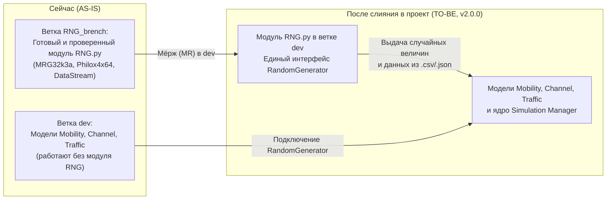

# SPEC-FEAT-RNG-001 — Модуль генерации случайных последовательностей (RNG) и его подключение к симулятору

> Ответственный: Шаимов Богдан (RNG)  
> Проверено по коду: ветка `RNG_brench`, коммит `RNG_brenсh2d2f164`| Обновлено: `2026-10-21`  
> Статус: Модуль разработан и протестирован автономно, ожидает слияния (MR) в ветку `dev`.  
> Связанные документы: [README.md](../../README.md) | [diagrams.md](../diagrams.md) | [audit.md](../audit.md) | [features.md](../features.md)

---

## 1. Цель и назначение

Сейчас модуль `RNG.py` (v1.2.0) полностью написан и проверен в отдельной ветке `RNG_brench`, но в основной ветке проекта (`dev`) его ещё нет. 

**Цель этой спецификации** — описать устройство готового модуля `RNG`, его входные параметры и методы, чтобы:
1. Влить модуль `RNG.py` в основную ветку проекта как самостоятельный и независимый компонент (под архитектуру `PyScheduler v2.0.0`).
2. Дать моделям мобильности (`Mobility`), радиоканала (`Channel`), трафика (`Traffic`) и ядру симуляции (`Simulation Manager`) единый и понятный инструмент для получения случайных чисел вместо разрозненных вызовов стандартного `random`.
3. Обеспечить полную повторяемость экспериментов: при одних и тех же настройках симуляция всегда выдаёт одинаковый результат, а при смене индекса потока (`base_stream_idx`) или номера прогона (`run_idx`) можно быстро получать новые сгенерированные случайные данные без изменения остальных параметров сценария.

---

## 2. Что входит и что не входит в задачу

**Входит:**
- Сам модуль `RNG.py` с тремя режимами работы: математическим алгоритмом `MRG32k3a` (как в NS-3), быстрым 64-битным алгоритмом `Philox4x64` и чтением заранее заготовленных датасетов из файлов `.json` и `.csv` (`DataStream`).
- Единый класс `RandomGenerator`, через который другие модули запрашивают случайные числа с нужным распределением (`uniform`, `normal`, `exponential`, `get_integer`).
- Проверка тестами гипотез из ревизии кода (`[BUG-RNG-001](../audit.md#bug-rng-001)`, `[BUG-RNG-002](../audit.md#bug-rng-002)`, `[OPT-RNG-001](../audit.md#opt-rng-001)`) и точечные правки в `RNG.py`, если они подтвердятся.
- Чистка старых тестов модуля от дубликатов и перевод их на универсальный вид (`[FEAT-RNG-002](../features.md#feat-rng-002)`).
- Вливание модуля `RNG.py`, документации и тестов в основную ветку `dev`.

**Не входит:**
- Внесение изменений внутрь чужих модулей (`MOBILITY_MODEL.py`, `CHANNEL_MODEL.py`, `TRAFFIC_MODEL.py`, `SIMULATION_MANAGER.py`) — подключение `RandomGenerator` внутри этих файлов выполняют их ответственные разработчики после того, как `RNG.py` появится в ветке `dev`.
- Доработка чтения многоколоночных CSV и ключей JSON по разным подпотокам (`[FEAT-RNG-003](../features.md#feat-rng-003)` / `[DEBT-RNG-001](../audit.md#debt-rng-001)`) — это отдельная идея на будущее, если такой формат понадобится владельцам моделей.

---

## 3. Архитектура и состав модуля RNG

### 3.1. Из чего состоит `RNG.py`

Модуль написан на стандартном Python 3.12 и не зависит ни от каких других файлов проекта. Внутри него четыре класса:

| Класс в `RNG.py` | За что отвечает | Как работает внутри |
|---|---|---|
| `RngStream` | Математический генератор **MRG32k3a** | Алгоритм взят из симулятора **NS-3** и полностью свалидирован с ним побитово. При первом запуске один раз считает и кэширует матрицы перехода, чтобы мгновенно сдвигать состояние генератора при смене индекса потока (`stream_idx`) или прогона (`run_idx`). |
| `PhiloxStream` | Математический генератор **Philox4x64** | Быстрый 64-битный генератор на основе счётчика (10 раундов шифрования). Свалидирован с эталоном в Python. За один проход генерирует сразу 4 числа в буфер и отдаёт их по одному, нормализуя к диапазону $[0.0, 1.0)$. |
| `DataStream` | Чтение готовых чисел из **JSON и CSV** | Используется, когда вместо генерации случайных чисел нужно прогнать симуляцию на заранее заготовленном датасете. Загружает числа из `.json` или `.csv` в очередь `deque`. Если включён флаг `loop=True` (по умолчанию), после конца файла начинает читать данные заново по кругу. |
| `RandomGenerator` | **Единая точка входа** для остальных модулей | Главный класс, с которым работают внешние модули. Внутри себя сам создаёт нужный генератор (`MRG32k3a`, `Philox` или `File`) и переводит базовые числа в четыре распределения: равномерное, нормальное, экспоненциальное и целочисленное. |

### 3.2. Схема перехода: «Как сейчас (AS-IS)» → «Как будет (TO-BE)»

Сейчас `RNG.py` находится отдельно в ветке `RNG_brench`. После слияния в `dev` он станет общим независимым модулем, к которому через `RandomGenerator` смогут обращаться модели и ядро симулятора:



---

## 4. Интерфейс модуля (как работать с `RandomGenerator`)

Другим разработчикам не нужно вызывать `RngStream`, `PhiloxStream` или `DataStream` напрямую. Для работы достаточно импортировать один класс:

```python
from RNG import RandomGenerator
```

### 4.1. Создание генератора и входные параметры

```python
rng = RandomGenerator(
    seed=12345,
    base_stream_idx=0,
    run_idx=1,
    engine='MRG32k3a',
    filepath=None
)
```

**Что означает каждый параметр:**
- `seed` (`int`, по умолчанию `12345`) — начальное зерно генератора (если передать `0`, автоматически заменится на `12345`).
- `base_stream_idx` (`int`, по умолчанию `0`) — базовый индекс потока. Используется для того, чтобы при полностью одинаковых параметрах симуляции можно было просто поменять индекс потока и сразу получить новую независимую последовательность случайных данных.
- `run_idx` (`int`, по умолчанию `1`) — номер прогона симуляции (позволяет переключать независимые подпотоки между разными запусками одного эксперимента).
- `engine` (`str`, по умолчанию `'MRG32k3a'`) — выбор режима работы:
  - `'MRG32k3a'` — генератор из NS-3;
  - `'Philox'` — 64-битный генератор Philox;
  - `'File'` — чтение готовых чисел из файла.
- `filepath` (`str | None`, по умолчанию `None`) — путь к файлу `.json` или `.csv` (обязателен, если выбран режим `engine='File'`).

### 4.2. Доступные методы получения чисел

Во всех четырёх методах есть необязательный параметр `stream_offset` (по умолчанию `0`). Он прибавляется к `base_stream_idx` (`base_stream_idx + stream_offset`) и позволяет внутри одного генератора разделить разные случайные величины по своим подпотокам.

| Метод | Аргументы | Что возвращает |
|---|---|---|
| `rng.uniform(...)` | `min_val=0.0, max_val=1.0, stream_offset=0` | Случайное дробное число (`float`) в диапазоне от `min_val` до `max_val`. В режиме `'File'` возвращает следующее готовое число из файла. |
| `rng.normal(...)` | `mean=0.0, variance=1.0, bound=float('inf'), stream_offset=0` | Случайное число (`float`) из нормального распределения со средним `mean`, дисперсией `variance` и ограничением отклонения `bound`. Внутри использует метод Бокса — Мюллера с кэшированием второго числа для ускорения работы. В режиме `'File'` возвращает число из файла. |
| `rng.exponential(...)` | `mean=1.0, bound=0.0, stream_offset=0` | Случайное число (`float`) из экспоненциального распределения со средним `mean` и верхним пределом `bound` (если `bound=0.0`, верхнего предела нет). В режиме `'File'` возвращает число из файла. |
| `rng.get_integer(...)` | `min_val, max_val, stream_offset=0` | Случайное целое число (`int`) в диапазоне от `min_val` до `max_val` включительно. В режиме `'File'` возвращает `int(...)` от числа из файла. |

### 4.3. Обработка ошибок

Модуль сам проверяет базовые ошибки при работе с файлами:
- Если выбран `engine='File'`, но не передан путь `filepath` — выбрасывается `ValueError`.
- Если указанный файл не найден на диске — выбрасывается `FileNotFoundError`.
- Если у файла неподдерживаемое расширение (не `.json` и не `.csv`) или в файле нет чисел — выбрасывается `ValueError`.
- Если в `DataStream` выключено зацикливание (`loop=False`) и числа в файле закончились — выбрасывается `StopIteration`.

---

## 5. Зависимости и взаимодействие с другими модулями

Сам модуль `RNG.py` полностью автономен и ни от каких других модулей не зависит. Чтобы он заработал в составе всей симуляции после мёржа в `dev`, потребуется взаимодействие с двумя направлениями:

1. **Модели `Mobility`, `Channel`, `Traffic` (Ответственный: Андрей К.):**
   - Подключить использование `RandomGenerator` внутри моделей мобильности (расчёт траекторий движения абонентов), радиоканала (расчёт замираний/шума) и трафика (генерация пакетов).
   - Согласовать, какие именно параметры (`seed`, `base_stream_idx`, `engine`, `filepath`) модели должны принимать при инициализации.
2. **Ядро симуляции `Simulation Manager` / API (Ответственный: Александр):**
   - Предусмотреть в настройках симуляции передачу параметров генератора (`seed`, `base_stream_idx`, `run_idx`, `engine` или путь к файлу датасета) в модели при запуске сценария.

---

## 6. План реализации по шагам

Ниже перечислены задачи, которые предстоит выполнить для доведения тестов, проверки гипотез ревизии и интеграции модуля в проект (оценки даны для Planning Poker по шкале 1/2/3/5/8):

| ID | Задача | Что нужно сделать и какой результат ожидается | Оценка |
|---|---|---|---|
| **T1** | Проверить гипотезы из `audit.md` (`[BUG-RNG-001](../audit.md#bug-rng-001)`, `[BUG-RNG-002](../audit.md#bug-rng-002)`, `[OPT-RNG-001](../audit.md#opt-rng-001)`) | Написать проверочные тесты для отрицательного `min_val` в `get_integer` и отрицательного `bound` в `normal`/`exponential`. При подтверждении гипотез заменить `int()` на `math.floor()` в `get_integer`, добавить проверку `bound >= 0` и вынести `math.sqrt(variance)` до цикла в `normal`. Обновить статусы в `audit.md`. | 2 |
| **T2** | Привести в порядок тесты модуля `RNG` (`[FEAT-RNG-002](../features.md#feat-rng-002)`) | Изучить паттерны проектирования универсальных тестов, очистить старый код тестов `RNG` от дубликатов и переписать проверки в едином параметризованном виде (`pytest`). | 3 |
| **T3** | Влить модуль `RNG` и документацию в ветку `dev` (MR) | Создать Merge Request от актуального `dev`: включить `RNG.py`, папку документации (`README.md`, `diagrams.md`, `audit.md`, `features.md`, `specs/SPEC-FEAT-RNG-001.md`) и обновлённые универсальные тесты. | 1 |
| **T4** | Согласовать и подключить `RNG` к моделям и ядру (совместно с Андреем К. и Александром) | Договориться о передаче параметров генератора из настроек симуляции и перевести генерацию случайных чисел в моделях `Mobility`, `Channel`, `Traffic` на методы `RandomGenerator`. | 5 |

---

## 7. Способы проверки и критерии готовности

Работа по спецификации считается выполненной, когда проходят следующие проверки:
1. **Валидация алгоритмов генерации:** результаты `RngStream` (`MRG32k3a`) побитово совпадают с эталонным выводом из симулятора NS-3, а результаты `PhiloxStream` (`Philox4x64`) совпадают с эталонной реализацией в Python.
2. **Проверка работы с файлами (`DataStream`):** тестовые датасеты `.csv` и `.json` считываются без потерь, при `loop=True` буфер корректно зацикливается, а при `loop=False` выбрасывает `StopIteration` в конце файла.
3. **Проверка распределений и крайних случаев:** значения `uniform`, `normal`, `exponential` и `get_integer` укладываются в заданные границы (`min_val`, `max_val`, `bound`), включая работу `get_integer` с отрицательными границами.
4. **Проверка повторяемости и смены потока:** два запуска генератора с одинаковыми `(seed, base_stream_idx, run_idx)` дают идентичные последовательности чисел, а изменение `base_stream_idx` или `run_idx` мгновенно даёт новую независимую последовательность.
5. **Чистота тестов и документации:** все универсальные тесты проходят через `pytest`, документация и спецификация лежат в репозитории.
